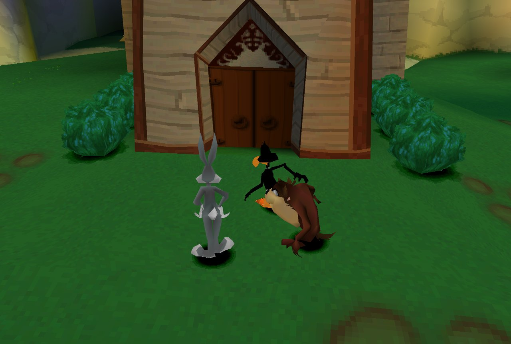
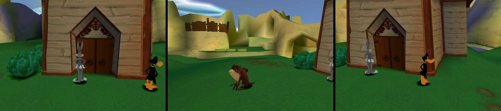
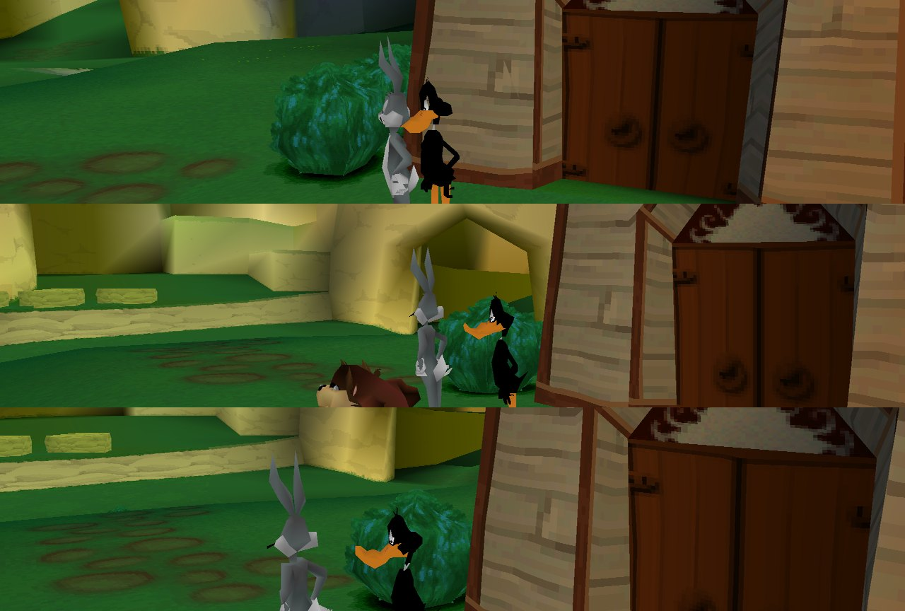
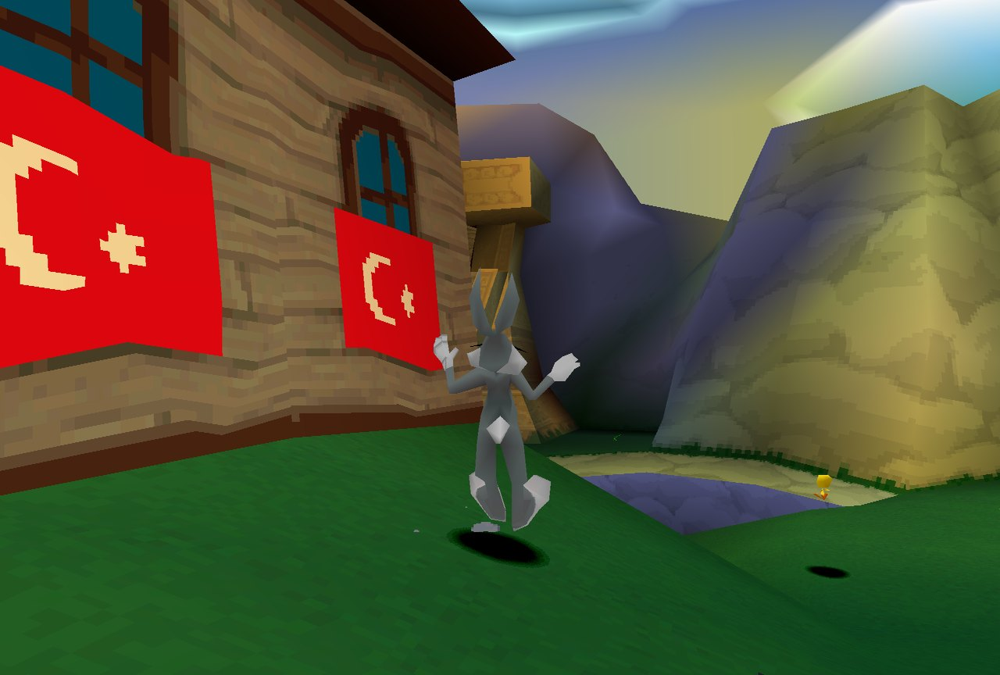
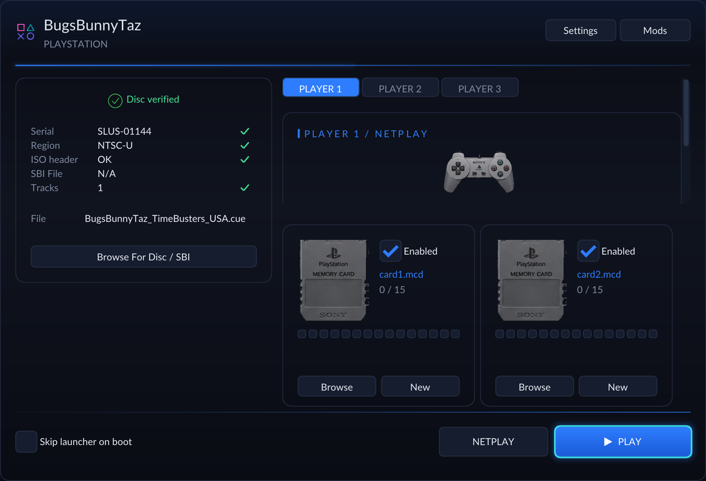
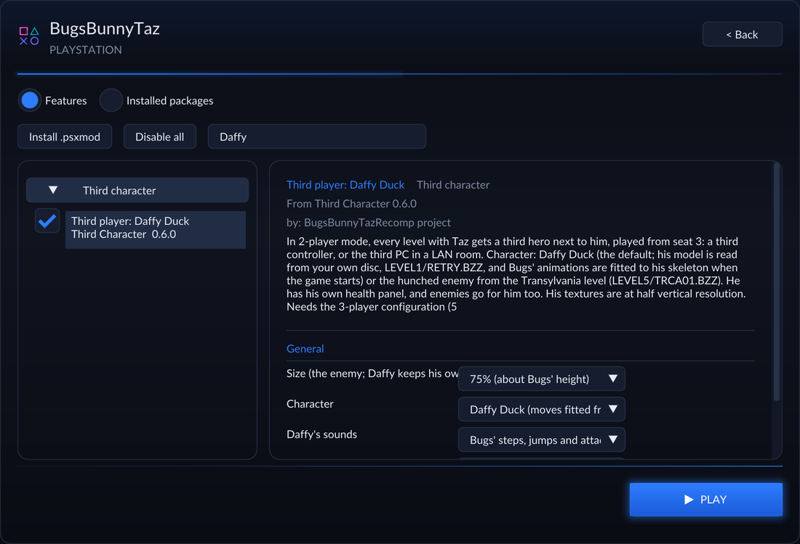

# Bugs Bunny & Taz: Time Busters — Recompiled

A native PC version of *Bugs Bunny & Taz: Time Busters* (PS1, USA), made by
static recompilation with [psxrecomp](https://github.com/RetroPortingToolKit/psxrecomp)
and its launcher [recomp-ui](https://github.com/RetroPortingToolKit/recomp-ui).
It runs on macOS and Windows.

It adds **Daffy Duck as a third playable character**, for up to three
players. They can share one PC, or each play on their own PC over a LAN or
Radmin VPN, each with a full-screen view of their own player.



**This repository holds no game data and no game code.** You need your own
copy of the game (the USA disc, SLUS-01144). The game is built from that copy
on your own machine.

| | |
|---|---|
| Players | 1-3 (the third player is Daffy) |
| Region | USA (SLUS-01144) |
| Original developer | Artificial Mind and Movement |
| Original publisher | Infogrames |
| Year | 2000 |

Players' guide, with every step for a match:
[docs/PLAYING_TOGETHER.md](docs/PLAYING_TOGETHER.md).

## What the mods add

All of them are on by default; nothing has to be set. Each one can be
switched off, and its options changed, on the launcher's **Mods** page (see
[The launcher](#the-launcher)). In a LAN room the host's Mods count for every
PC.

### Third player: Daffy Duck

- **Who:** Daffy joins as a third hero next to Taz in every level that has
  Taz.
  - He has his own health panel (under Bugs').
  - Enemies go for him too.
  - □ is his attack, a kick that hits like Taz's spin.
  - His model is read from your own disc, and Bugs' animations are fitted to
    his skeleton.
- **When he comes:** only when there is a third player.
  - **Online:** three players seated in the room; seat 3 is Daffy.
  - **One PC:** choose a controller on the launcher's **PLAYER 3** card;
    Daffy comes at the next level start once Player 3 presses any button. To
    have him in the first level, press before START GAME.
  - With two players he stays away.
- **When he is out:** he comes back next to Taz after 5 seconds (next to Bugs
  if Taz is out), with full health and no life lost. A package that brings a
  player back brings him back too.
- **Options** (Mods -> Third player: Daffy Duck):
  - **Character:** Daffy Duck, or the hunched enemy from the Transylvania level.
  - **Daffy's sounds:** Bugs' steps, jumps and attack; Taz's; or none of Taz's.
  - **When Daffy is out:** after 5 seconds; or the game's rule for Bugs and Taz,
    which is when the team comes back (a life lost) or a package.

### Own view for every player

In the original game two players share one screen and one camera. With this
mod every player gets their own camera:
- **In a match:** every PC shows its own player full screen and follows them
  with its own camera.
- **On one PC:** the game keeps its shared screen by default. Option
  **On one PC** -> *Split screen* gives each player a band of their own,
  player 1 on top.



*One match on three PCs: PC 1 shows Bugs, PC 2 Taz, PC 3 Daffy.*



*Split screen on one PC, one band per player.*

**It costs speed.** Every PC draws the scene a second time every frame for
its own view:
- The start files cap the picture at 2x so that this extra drawing fits in a
  frame.
- In the first Windows test (three PCs) it was still too slow, so the host
  turned the own view off for the match, and the speed was fine.
- If a match is slow or choppy, switch it off on the host (Mods -> Own view
  for every player). Everyone then plays on the game's shared camera.
- With three views, a few heavy scenes run below full speed: the Viking boss
  level and a few others, at about 60-85 %. This is the emulated graphics
  chip's time, a framework limit.

### Quick start

- Straight to the game's main menu: no logos, no language screen, no PRESS
  START.
- No long new-game intro, and shorter loading screens.
- The emulated CD reads at 2x.
- In a LAN room the number of players comes from the seats, so the ONE /
  TWO PLAYERS menu is skipped.
- **Options:**
  - the game's language: English, Français, Español, or "Ask";
  - each skip on its own;
  - the CD speed, 1x to 4x.

### Decorations: a Turkish flag

A Turkish flag hangs from the arched windows on both sides of Granny's house
in Granwich, the way flags hang from windows on national holidays. It is
drawn into the game's own wall texture at the game's resolution, so every
renderer shows it, near and far.



### The picture

The game draws in true colour, without the PlayStation's dither pattern of
fine dots. To bring the dots back: Mods -> Image Filtering, turn it on, then
Dithering = Native (PS1). The framework's look options (Image Filtering,
Internal Resolution, CRT Filter, ...) are each PC's own choice, also in a
match.

## The launcher

The game starts in its launcher:
- **PLAYER 1 / 2 / 3 cards:** choose each player's controller. Online, every
  PC sets only its own PLAYER 1; PLAYER 2 and 3 are for players on one PC.
  A keyboard player needs keys of their own (Configure).
- **Mods:** every feature above, with its options on the right.
- **NETPLAY -> LAN / Direct IP:** host or join a room.
- **PLAY:** starts the game.





## Known limits

- **Matches ending:** over Radmin VPN, matches ended on every PC after a few
  minutes with no PC crashed. The start files now wait 5 s, not 1.5 s,
  before a silent PC ends the match; that is not yet tested in a real match.
  Before every match, everyone starts the game fresh.
- **Level change:** in three-view split screen on one PC, a rare stop at one
  level change has been seen.
- **Mac and Windows together:** not promised by the framework and not tried
  yet. Every player uses the same Windows build.

## Playing on Windows

Today players use a players' ZIP. It holds no game data and no game code.
Each PC builds the game once from its own disc:
1. Extract the ZIP.
2. Double-click `Setup.bat`.
3. Choose the disc once.
4. Play from the desktop shortcut.

The ZIP is made with `tools/make_player_zip.py`. See
[windows/START_HERE.txt](windows/START_HERE.txt) and
[docs/WINDOWS_AND_LAN.md](docs/WINDOWS_AND_LAN.md), section 8.

A ready-built package (extract, point it at the disc, play) is planned to
replace this. It will be shared privately with players, because it holds the
compiled game.

## Building (developers)

[docs/WINDOWS_AND_LAN.md](docs/WINDOWS_AND_LAN.md) covers three topics:
- building on a Windows PC;
- the players' ZIP;
- a LAN or Radmin VPN match between two or three machines.

The disc copy sits next to the repository (`../disc/`, as `game.toml` says).

```bash
git clone --recurse-submodules https://github.com/ozanorfa/Bugs-Bunny-Taz-Time-Busters-Recomp.git BugsBunnyTazRecomp
cd BugsBunnyTazRecomp
./psxrecomp/tools/ci/build_emitters.sh
python3 psxrecomp/psxrecomp_cli.py generate \
  --config game.toml --project-root . --disc ../disc/<your>.cue
# generated/ stays out of git (it is derived from the disc).
# rebuild configures, builds and stages overlay_toolchain/ beside the runtime,
# so streamed overlays can be compiled to native code (a bare cmake build
# skips that step and leaves every overlay gap interpreted).
python3 psxrecomp/psxrecomp_cli.py rebuild \
  --config game.toml --project-root . --build-dir build-release --no-pgo
```

Three players need `game_3p.toml`, which `tools/make_3p_toml.py` writes from
`game.toml`. The mods' code is in [src/mods/](src/mods), and their packages
are in [mods/preloaded/packages/](mods/preloaded/packages). The tests are in
[tests/](tests).

The framework's prebuilt packager (`scripts/package_release.sh`) ships code
recompiled from the game's program. It is for developers only, not for
sharing; see `psxrecomp/docs/RELEASING_A_TITLE.md`.

### Symbols

`symbols.toml` is the progressive symbol map. `python3 tools/sync_symbols.py`
turns it into `psx_symbols.h` (`PSX_FN_*`). See `psxrecomp/docs/SYMBOLS.md`.

### Notes in code comments

Comments in the code and tests refer to `NOTES.md` sections and `BUGS #<n>`
entries. Those are the maintainer's working notes and bug list, kept next to
the repository and not published. The comments say what matters in place.
Comments that mention the Fighting Force project mean a sibling PSXRecomp
port by the same maintainer; the two projects share findings.

### Framework pins

The submodule gitlinks are authoritative: `psxrecomp`, `recomp-ui` and the
nested `recomp-net`. `framework_pins.txt` records the same commits. Bump the
submodules deliberately, one tested step at a time.

## Legal

- You must own the original game. Disc images, BIOS dumps, the recompiled
  game code (`generated/`) and anything else taken from the disc are
  gitignored and are never committed. Releases run on the bundled,
  MIT-licensed OpenBIOS.
- This is an unofficial fan project. It is not affiliated with or endorsed
  by Warner Bros., Infogrames / Atari, Artificial Mind and Movement or Sony.
- Bugs Bunny, Taz, Daffy Duck and Looney Tunes are trademarks of Warner Bros.
  Entertainment Inc.
- The screenshots in `docs/images/` show the original game's characters and
  artwork, which belong to their owners.

## License

The code and documents written for this project are under the
[MIT License](LICENSE): use, change and share them as you like. See
[NOTICE.md](NOTICE.md) for the parts that keep other terms:

| Part | License |
|---|---|
| [psxrecomp](https://github.com/RetroPortingToolKit/psxrecomp) (submodule) | PolyForm Noncommercial 1.0.0 |
| [recomp-ui](https://github.com/RetroPortingToolKit/recomp-ui) (submodule) | MIT |
| Files started from psxrecomp's project templates | psxrecomp's license for the template material |

A built game includes the psxrecomp runtime, so you can use and share a build
for noncommercial purposes only.

The original game and everything on its disc belong to their owners. No
license here covers them.
